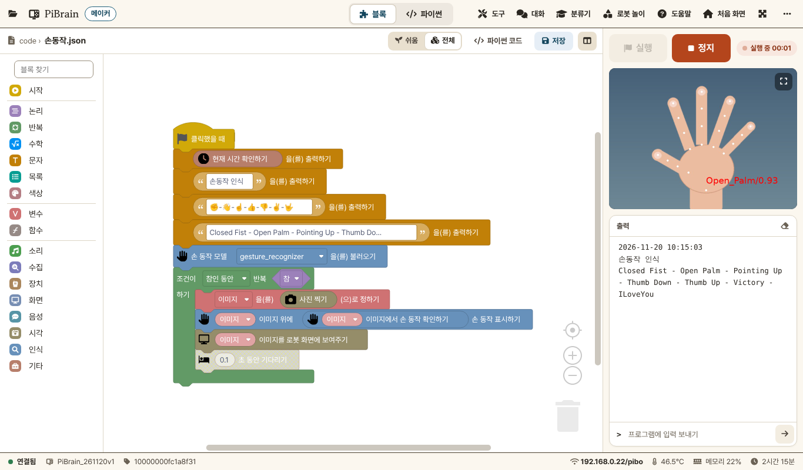
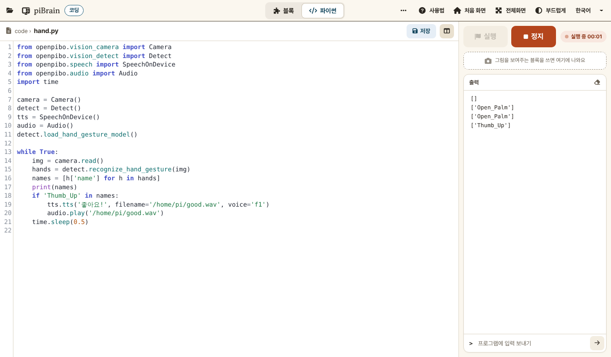
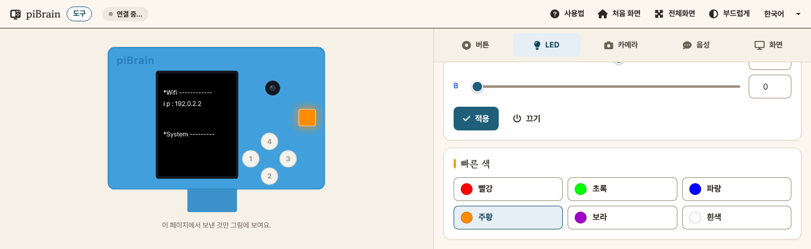
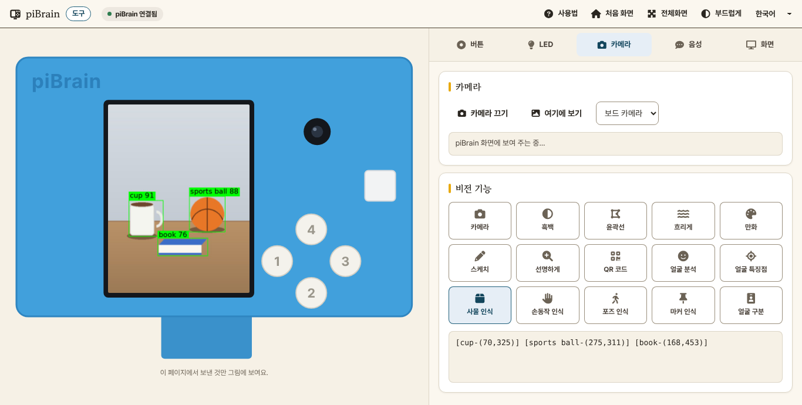
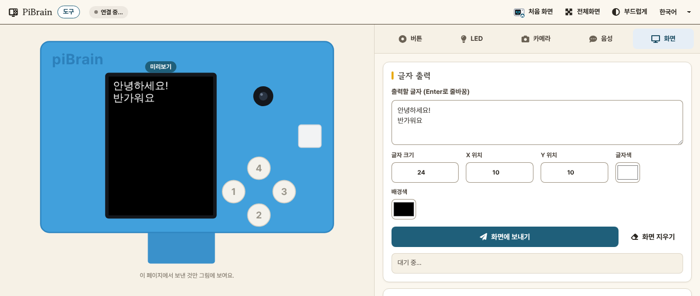
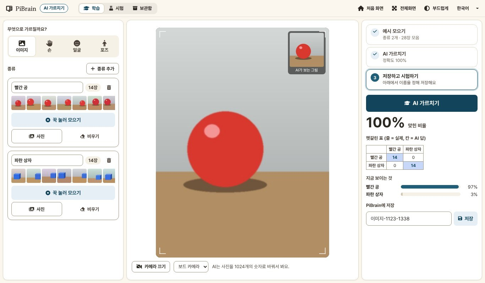

# piBrain 메이커

piBrain 메이커는 브라우저로 여는 piBrain 개발 환경입니다. 태블릿·노트북이 piBrain 과 같은 WiFi 에 붙어 있으면
주소창에 **piBrain 의 IP 주소**(piBrain 화면에 처음 나옵니다)를 적어 엽니다. 설치할 것은 없습니다.

주소를 열면 **처음 화면**(학습지 한 장)이 나옵니다. 큰 그림 단추를 눌러 앱으로 들어가고, 앱 위 줄의 [처음 화면](집 단추)으로 돌아옵니다.
줄 1 **만들기**(코딩 · 도구 · AI 가르치기 · 대화), 줄 2 **놀이 · 배우기**(카드 코딩 · 로봇 놀이), 줄 3 **설정 · 도움말**(설정 · 도움말)입니다.
지금 켜져 있는 앱에는 빨간 도장 '켜져 있음', 지난번에 쓴 앱에는 노란 꼬리표가 붙고, 오른쪽에는 로봇 상태와 [이어서 하기](최근 파일·내가 가르친 AI)가 있습니다.
[설정]에서 화면 밝기 · WiFi 설정(여기서 바로 WiFi 를 골라 연결) · 로봇 화면 처음으로 · H/W 검수 · **로봇 정보**(버전 · 올린 때 · 저장 공간 · 모델 판 — [복사]로 문의할 때 그대로 보냅니다) · 공장 초기화 · 전원 끄기 · 소스 코드와 라이선스를 봅니다. 처음 화면 맨 아래에는 제품 · 버전 · 도움말 · 라이선스가 있습니다.
로봇 상태(배터리 · 온도 · 메모리 · WiFi · 시리얼 · 켜진 시간)도 처음 화면에서 봅니다. 모든 앱의 위 줄은 같은 모양입니다 — 왼쪽 앱 이름, 오른쪽 (앱 기능) · **[사용법]** · [처음 화면] · [전체화면] · [밝기] · 언어. [사용법]을 누르면 그 화면에서 할 수 있는 것 몇 줄과 이 도움말의 해당 절로 가는 링크가 나옵니다.

| 화면 | 하는 일 | 여는 곳 |
|---|---|---|
| **코딩** | 블록·파이썬으로 프로그램을 만들고 실행합니다 | `http://<piBrain IP>` → 처음 화면 [코딩] |
| **도구** | 버튼·LED·카메라·목소리·화면을 코드 없이 바로 써 봅니다 | 처음 화면 [도구] |
| **대화** | piBrain 안의 언어 모델(LLM)과 글로 대화합니다 | 처음 화면 [대화] |
| **AI 가르치기** | 카메라로 예시를 모아 나만의 AI 를 가르칩니다 | 처음 화면 [AI 가르치기] |
| **카드 코딩** | 초등학생이 카드로 로봇 친구에게 재주를 가르칩니다(코딩 없이) — 도전 · 만들기 · 내 재주. 처음 화면 위에 오늘 차시 · 모은 별 · 내 재주가 보입니다 | 처음 화면 [카드 코딩] |
| **로봇 놀이** | 로봇 친구를 돌보는 **키우기**와, 태블릿에서 칸을 칠하면 LCD 에 바로 나오는 **픽셀 그림**(움직이는 그림 · 그린 순서 다시 보기 · 내 그림첩) | 처음 화면 [로봇 놀이] |
| **도움말** | 지금 보고 있는 이 문서입니다 | 처음 화면 [도움말] |

```{note}
모든 기능은 **piBrain 안에서** 돌아갑니다(목소리 만들기·대화·분류기 포함). 인터넷이 필요한 것은
블록 [수집] 분류(위키백과·날씨·뉴스)뿐입니다.
```

(app-ide)=
## 코딩 (IDE)



- **위 줄**: 왼쪽 끝 폴더 단추로 **파일 서랍**을 엽니다. 가운데 [블록 | 파이썬] 으로 편집기를 바꾸고, 오른쪽은 [⋯](글자 크기 · 파이썬 편집기 테마 · 예제 열기) · [사용법] · [처음 화면] · [전체화면] · [밝기] · 언어로 다른 앱과 같습니다
- **파일 서랍**: 파일 목록, [추가](새 파일·새 폴더·올리기), 사진·소리 미리보기. 처음 열면 펼쳐져 있고, 파일을 열거나 편집기를 누르면 접힙니다.
  편집기 줄의 파일 이름을 눌러도 열립니다. 파일마다 오른쪽 아이콘으로 내려받기 · 이름 바꾸기 · **복사·옮기기** · 지우기를 합니다.
  복사·옮기기는 받을 폴더(code · myimage · myaudio · mymodel · usb)를 고르고 [복사] 나 [옮기기] 를 누릅니다. USB 와 로봇 사이도 됩니다.
  같은 이름이 있으면 `이름_1` 처럼 새 이름으로 저장합니다
- **처음 화면**: 파일을 열기 전에는 작업판 가운데에 **[새 파일] · [예제 열기] · [내 파일 열기]** 가 나옵니다. [예제 열기]는 예제를 **카드**(제목 · 배우는 것 · 난이도 ★ · 시간 · 필요한 것)로 보여 주고, 카드를 누르면 그 예제를 블록으로 엽니다. 파일을 연 뒤에는 위 [⋯] → [예제 열기]로 다시 엽니다([폴더에서 보기]는 예제 폴더를 서랍에 엽니다).
  파일을 열면 편집기 줄에 `code › 손동작.json` 처럼 폴더와 이름이 보입니다(전체 경로는 마우스를 올리면 나옵니다)
- **오른쪽 실행 화면**: **[실행] [정지]** 와 실행 상태, 화면 출력(`(이미지) 이미지를 모니터 화면에 보여주기` 블록으로 보낸 그림), 실행 출력, 프로그램에 입력 보내기.
  편집기 줄 오른쪽 끝 단추로 접고 펼 수 있고, 실행하면 다시 펼쳐집니다. 서랍과 실행 화면을 둘 다 접으면 블록을 넓게 씁니다
- **블록**: 왼쪽 분류에서 블록을 끌어다 놓습니다. 맨 위 **블록 찾기** 에 '소리'·'얼굴' 처럼 적으면 해당 블록이 나옵니다.
  편집기 줄의 **[쉬움 | 전체]** 에서 [쉬움]을 고르면 처음 배우는 학생용 블록(계속 반복·동작·불빛·소리·센서·AI 눈·점수 등)만 보입니다.
  [파이썬 코드] 를 누르면 블록이 만든 파이썬 코드를 볼 수 있습니다. 블록 목록은 왼쪽 **BLOCK** 을 보세요.
- **오류가 나면**: 출력 위 빨간 상자에 어디서(블록 모드는 빨간 테두리로 표시한 블록, 파이썬은 몇 번째 줄) 무슨 오류인지 쉬운 말로 나옵니다.
  [블록 보기]·[줄 보기] 로 그 자리로 가고, 블록을 고치면 빨간 테두리는 없어집니다



- **파이썬**: `openpibo` 패키지로 piBrain의 기능을 씁니다. `print` 는 오른쪽 [출력] 에, `input` 은 그 아래 입력 칸으로 받습니다.
  API 는 왼쪽 **PYTHON** 을 보세요
- **단축키**: Ctrl+S 저장 · Ctrl+Enter 실행(맥은 ⌘). 저장하지 않은 채 탭을 닫거나 새로 고치면 브라우저가 한 번 묻습니다
- 실행한 프로그램은 piBrain 안에서 돕니다. 멈추려면 [정지] 를 누릅니다

(app-tools)=
## 도구

piBrain 의 기능을 하나씩 코드 없이 써 봅니다. 오른쪽 위 탭에서 [버튼] [LED] [카메라] [음성] [화면] 을 고릅니다.
왼쪽의 piBrain 그림에서 버튼을 누르면 그 버튼이, LED 색을 바꾸면 흰 네모(LED)가, 화면에 글자를 보내면 화면이 같이 바뀝니다. [카메라] 의 [여기에 보기] 사진도 그림 속 화면에 나오고, [음성] 으로 말하는 동안에는 그림 위에 말풍선이 뜨고, [화면] 탭에서 보내기 전 글자는 '미리보기' 로 보입니다(이 페이지에서 보낸 것만 그림에 나옵니다).

- **버튼**: 버튼 4개가 눌렸는지 실시간으로 보여 줍니다



- **LED**: 색을 골라 [적용] 하면 LED 가 그 색으로 켜집니다



- **카메라**: [카메라 켜기] 를 누르면 카메라 화면이 **piBrain 화면**에 나옵니다. 비전 기능(흑백·윤곽선·만화·QR 코드·얼굴 분석·
  사물 인식·손동작 인식·포즈 인식·마커 인식 등)을 누르면 piBrain 화면에 바로 적용되고, 결과는 오른쪽 아래에 글자로 나옵니다.
  **얼굴 구분**은 이름을 적고 [등록]한 얼굴을 알아봅니다(등록한 얼굴은 블록 `얼굴 사전을 code facedb 에서 불러오기` 로 프로그램에서도 씁니다).
  [여기에 보기]를 누르면 지금 화면을 브라우저에서도 봅니다.
  USB 카메라를 꽂았으면 [여기에 보기] 옆 고르는 칸에서 **보드 카메라 / USB 카메라**를 바꿔 볼 수 있습니다(V4L2 를 지원하는 USB 카메라면 기종은 상관없어요)
- **음성**: 목소리 10가지(남성 1~5, 여성 1~5)와 기계음(espeak, 영어 글자만) 중에서 골라 [말하기]로 글자를 말하게 합니다. 한국어·영어는 자동으로 알아봅니다



- **화면**: 글자·크기·위치·색을 정해 화면(LCD 240×320)에 띄웁니다. [처음 화면으로] 는 IP 주소가 나오는 첫 화면으로 되돌립니다

(app-classifier)=
## AI 가르치기 (분류기)



카메라로 예시를 모아 AI 에게 '이건 고양이, 이건 음식' 처럼 가르칩니다. piBrain 카메라는 세로(3:4)라 화면도 세로로 나옵니다.

오른쪽 칸 위의 **학습 순서**(① 예시 모으기 → ② AI 가르치기 → ③ 저장하고 시험하기)가 지금 할 단계를 파랑 테두리로, 끝난 단계를 체크로 보여 줍니다.

1. **무엇으로 가르칠까요?** — 이미지(사진 전체) · 손(손 모양) · 얼굴(표정) · 포즈(몸 자세) 중에서 고릅니다
2. **종류** 마다 이름을 적고 **[꾹 눌러 모으기]** 를 누르고 있는 동안 예시가 모입니다. [사진] 으로 파일을 올려도 됩니다.
   카메라 아래 고르는 칸에서 USB 카메라로 바꿀 수 있어요 — 학습할 때와 쓸 때 같은 카메라를 쓰면 더 잘 맞습니다
3. **[AI 가르치기]** — 태블릿·노트북 브라우저에서 몇 초 만에 배웁니다. 맞힌 비율·헷갈린 표·지금 보이는 것의 점수가 나옵니다
4. **[저장]** — piBrain 의 `/home/pi/mymodel/<모델 이름>` 에 저장됩니다
5. [코딩]에서 블록 `분류 모델 [mymodel] (모델 이름) 을(를) 불러오기` → `(이미지) 이미지를 분류 모델로 알아보기` 로 씁니다.
   `(이미지) 이미지 위에 분류 결과 표시하기` 는 본 손·얼굴·몸의 점과 종류 이름을 그림에 그립니다

[시험] 탭에서 저장한 모델을 다시 써 보고, [보관함] 에서 시험·이어서 배우기·이름 바꾸기·내려받기(zip)·지우기를 합니다.

```{tip}
AI 가르치기는 처음 열 때 AI 파일(약 10MB)을 받습니다. 수업 전에 태블릿마다 한 번씩 열어 두면 수업 중에는 바로 뜹니다.
```

(app-chat)=
## 대화

piBrain 안에서 도는 언어 모델(LLM)과 글로 대화합니다. 처음 화면의 **모델 카드**에서 모델을 고르면 그때 모델을 올립니다. 고른 뒤에는 위 **[대화 모델]**이 나타나 거기서 바꿉니다
(처음 한 번은 준비하는 데 수십 초 걸립니다). 모델을 바꾸면 대화가 처음부터 다시 시작됩니다.

| 모델 | 무엇 |
|---|---|
| 일반 | 한국어·영어로 대화합니다. 도구는 쓰지 않습니다 |
| 더메이커 KO | 학생과 이야기하도록 배운 한국어 모델입니다. 말로 piBrain에게 일을 시킬 수 있습니다(아래 도구) |
| 더메이커 EN | 더메이커의 영어판입니다. 기기에 모델 파일이 없으면 '(없음)' 으로 나오고 고를 수 없습니다 |

더메이커는 말을 듣고 **스스로 도구를 골라 실행**합니다. 실행한 도구는 대답 아래에 작게 나옵니다(예: `불빛 · 빨강`).

| 도구 | 이렇게 말해 보세요 | 하는 일 |
|---|---|---|
| 불빛 | "빨간 불 켜 줘", "불 꺼 줘" | LED 색을 바꾸거나 끕니다(빨강·주황·노랑·초록·파랑·하늘·보라·분홍·하양) |
| 보기 | "앞에 뭐 있어?" | 카메라로 보고 본 것을 말합니다 |
| 움직이기 | "인사해 줘", "춤춰 줘" | 몸이 없어서 "움직일 수는 없어요" 라고 대답합니다 |

- "대화만 하자" 라고 하면 도구를 쓰지 않고, "이제 움직여도 돼" 라고 하면 다시 씁니다.
- [소리로 말하기] 를 켜면 piBrain이 대답을 소리로 말합니다(목소리·음량을 고를 수 있습니다).

블록 [음성] 의 `대화 모델 고르기` · `대화 서버 시작하기` · `AI에게 … (이)라고 말하기` 로 프로그램에서도 씁니다.
블록에서는 글자로만 대화하고 도구는 실행하지 않습니다.

```{note}
도구·대화·AI 가르치기·카드 코딩/로봇 놀이·H/W 검수는 **한 번에 하나만** 켜집니다. 하나를 열면 나머지는 꺼지고, [코딩]에서 프로그램을 실행해도 꺼집니다
(카메라·스피커·메모리를 나눠 쓰기 때문입니다). 꺼진 화면에는 [다시 켜기] 가 나옵니다.
```
