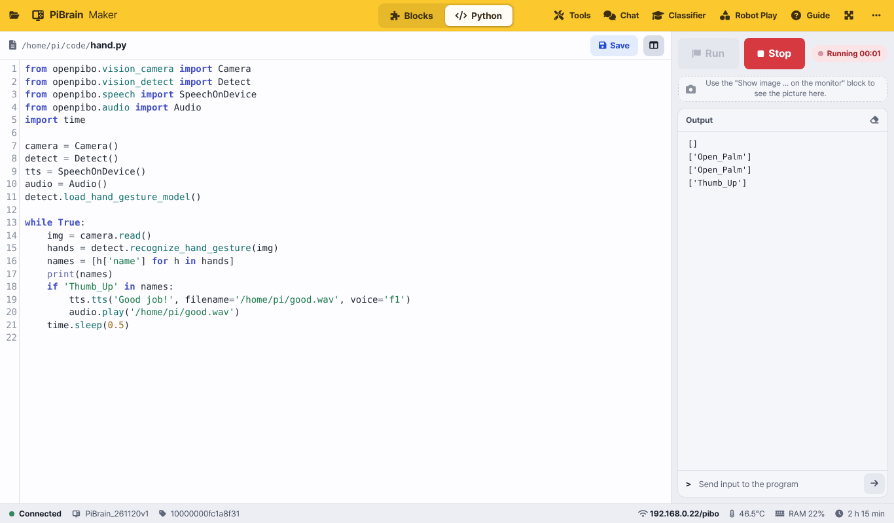
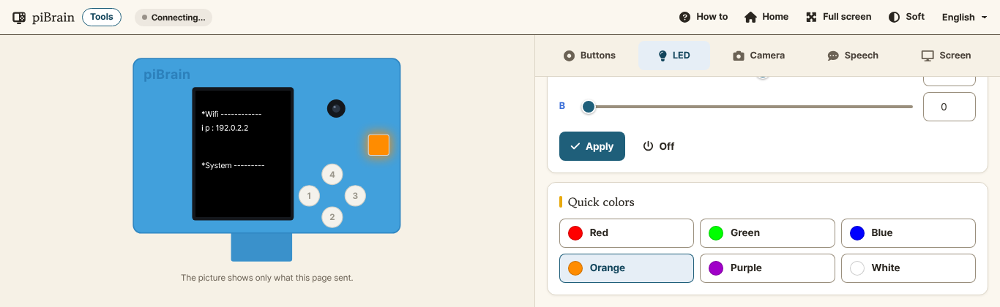
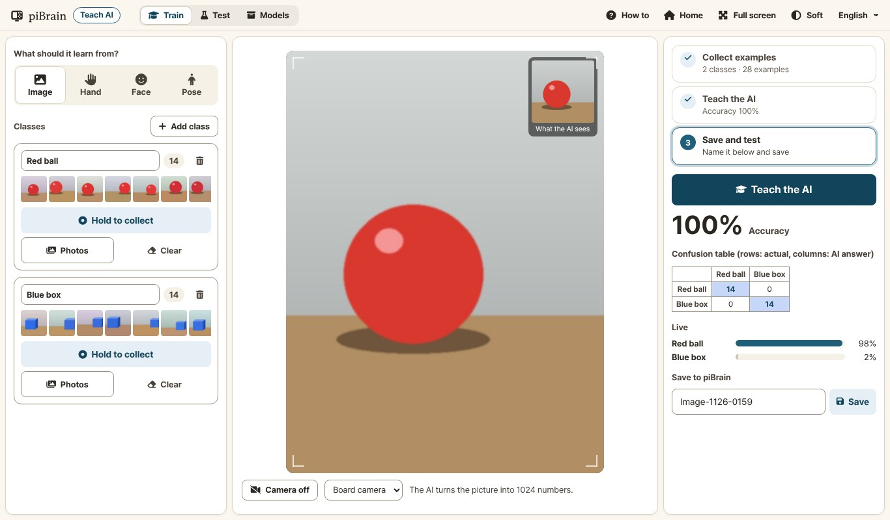

# piBrain Maker

piBrain Maker is the piBrain development environment you open in a web browser. When your tablet or laptop is on the same WiFi
as piBrain, type **piBrain's IP address** (shown on the piBrain screen at startup) into the address bar. There is nothing to install.

The address opens the **home screen** (a worksheet page). Tap a big picture button to enter an app, and use [Home] (house button) in an app's top bar to come back.
Row 1 **Make** (Coding · Tools · Teach AI · Chat), row 2 **Play & learn** (Card coding · Robot Play), row 3 **Settings and help** (Settings · Help).
The app that is running now gets a red 'Running' stamp and the one you used last gets a yellow tag; on the right are the robot status and [Continue] (recent files, AI you taught).
[Settings] has screen brightness, **screen style** (Worksheet · Developer — Developer is a gray-and-blue developer-tool look, applied to every device using this robot), WiFi settings (pick and join a WiFi right there), reset robot screen, H/W check, **robot info** (version, install date, storage and model versions — [Copy] it when you contact support), factory reset (deletes your files, models and Card coding/Robot play records and sets the WiFi back to the default), power off and the source code and license. The bottom of the home screen shows the product, version, Help and license.
The robot status (battery, temperature, memory, WiFi, serial, uptime) is on the home screen too. Every app has the same top bar — the app name on the left, and (app actions) · **[How to]** · [Home] · [Full screen] · [Brightness] · language on the right. [How to] shows a few lines on what you can do on that screen and a link to the matching part of this help.

| Screen | What it does | Where to open it |
|---|---|---|
| **Coding** | Build and run programs with blocks or Python | `http://<piBrain IP>` → home screen [Coding] |
| **Tools** | Try the buttons, LED, camera, voice and screen right away, without code | Home screen [Tools] |
| **Chat** | Chat in text with the language model (LLM) running inside piBrain | Home screen [Chat] |
| **Teach AI** | Collect examples with the camera and teach your own AI | Home screen [Teach AI] |
| **Card coding** | Elementary students teach the robot friend tricks with cards (no coding) — Challenges · Make · My tricks. The top of its start screen shows today's lesson, stars and tricks | Home screen [Card coding] |
| **Robot Play** | **Pet** (look after your robot friend) and **Pixel art** (color squares on the tablet and they appear on the LCD; animations, drawing replay and a sketchbook) | Home screen [Robot Play] |
| **Help** | This document | Home screen [Help] |

```{note}
Everything runs **inside piBrain** (voices, chat and the classifier included). Only the blocks in the
[Collect] category (Wikipedia, weather, news) need the internet, and that category is only in the Korean edition.
```

(app-ide)=
## Coding (IDE)


- **Top bar**: the folder button on the far left opens the **file drawer**. [Blocks | Python] in the middle switches the editor. On the right are [⋯] (font size · Python editor theme · open an example) · [How to] · [Home] · [Full screen] · [Brightness] · language, the same as every other app
- **File drawer**: the file list, [Add] (new file / new folder / upload) and a preview for pictures and sounds. It is open at first and closes when you open a file or tap the editor.
  Tapping the file name in the editor bar opens it again. The icons on each file download, rename, **copy or move** and delete it.
  To copy or move, choose a folder (code · myimage · myaudio · mymodel · usb) and tap [Copy] or [Move]. It works between a USB drive and the robot too.
  If the name is already taken, the copy gets a new name like `name_1`
- **Start screen**: before you open a file, the workspace shows **[New file] · [Open an example] · [Open my file]**. [Open an example] shows the examples as **cards** (title, what you learn, level ★, time, what you need); tap a card to open it in blocks as **a new file in the code folder** (the file is created when you save, and the original example stays the same). After a file is open, use [⋯] → [Open an example] at the top ([Show folder] opens the examples folder in the drawer).
  Once a file is open, the editor bar shows the folder and name, like `code › hand.json` (hover to see the full path)
- **Run panel on the right**: **[Run] [Stop]** with the run status, screen output (pictures sent with the `Show image … on the monitor` block), program output and sending input to the program.
  The button at the right end of the editor bar hides or shows it, and it opens again when you run a program. Hide both the drawer and the run panel to give the blocks the whole width
- **Blocks**: drag blocks out of the categories on the left. Type a word such as "sound" or "face" into **Search blocks** at the top to find blocks.
  Choose [Easy] in **[Easy | All]** on the editor bar to see only beginner blocks (repeat forever, motions, lights, sounds, sensors, AI eyes, score and more).
  [Python code] shows the Python code your blocks make. See **Blocks** on the left for every block.
- **When there is an error**: a red box above the output says where (the block outlined in red in block mode, or the line number in Python) and what went wrong in plain words.
  [Show block] / [Show line] takes you there, and the red outline goes away when you change the block



- **Python**: the `openpibo` package gives you every piBrain feature. `print` goes to [Output] on the right and `input` reads from the input box below it.
  See **Python** on the left for the API
- **Shortcuts**: Ctrl+S saves · Ctrl+Enter runs (⌘ on a Mac). If you close or reload the tab without saving, the browser asks once
- Programs run inside piBrain. Press [Stop] to stop one

(app-tools)=
## Tools

Try piBrain's features one at a time, without code. Pick [Buttons], [LED], [Camera], [Speech] or [Screen] in the tabs at the top right.
The piBrain picture on the left follows along: a pressed button lights up, the white square (LED) takes the LED color, and the screen shows the text you send. A [Show here] photo from [Camera] appears on the picture's screen, a speech bubble appears over the picture while [Speech] is talking, and unsent text on the [Screen] tab shows as a preview (only what this page sent appears in the picture).

- **Buttons**: shows live whether each of the 4 buttons is pressed



- **LED**: pick a color and press [Apply] to light the LED in that color


- **Camera**: press [Camera on] to show the camera view on the **piBrain screen**. Tap a vision feature (grayscale, edges, cartoon, QR code,
  face analysis, object detection, hand gestures, pose, markers…) to apply it to the piBrain screen right away; the result appears as text at the bottom right.
  **Face ID** recognizes faces you have named and [Registered] (programs can use them too, with the `Load the face dictionary from code facedb` block).
  [Show here] shows the current view in the browser too.
  If a USB camera is plugged in, switch between the **board camera and USB cameras** in the picker next to [Show here] (any USB camera that supports V4L2)
- **Speech**: pick one of ten voices (Male 1–5, Female 1–5) or the robot voice (espeak, English text only) and press [Speak] to let piBrain say your text. Korean and English are detected automatically


- **Screen**: choose the text, size, position and color and show it on the screen (LCD, 240×320). [Home screen] goes back to the first screen with the IP address

(app-classifier)=
## Teach AI (classifier)



Collect examples with the camera and teach the AI, for example "this is a cat, this is food". The piBrain camera is portrait (3:4), so the view is portrait too.

**Training steps** at the top of the right panel (① Collect examples → ② Teach the AI → ③ Save and test) outline the step to do now in blue and check off finished steps.

1. **What should it learn from?** — Image (the whole picture) · Hand (hand shape) · Face (expression) · Pose (body posture)
2. Name each **class** and keep pressing **[Hold to collect]** to collect examples. You can also upload files with [Photos].
   The picker under the camera switches to a USB camera — use the same camera for training and for use for better results
3. **[Teach the AI]** — the tablet or laptop browser learns in a few seconds and shows the accuracy, a confusion table and live scores
4. **[Save]** — saved on piBrain in `/home/pi/mymodel/<model name>`
5. In Coding use `Load classification model (mymodel) (model name)` → `Classify image (image) with the classification model`.
   `Show the classification result on image (image)` draws the hand, face or body points and the class name on the picture

The [Test] tab tries a saved model again. [Models] lets you test, keep training, rename, download (zip) or delete a model.

```{tip}
Teach AI downloads its AI files (about 10 MB) the first time it opens. Open it once on every tablet before class and it
will start right away during class.
```

(app-chat)=
## Chat

Chat in text with the language model (LLM) that runs inside piBrain. Choose a model from the **model cards** on the start screen, and the model loads then. After that, **[Chat model]** appears at the top so you can switch
(the first time takes several tens of seconds). Changing the model starts the chat over.

| Model | What it is |
|---|---|
| General | Chats in Korean and English. No tools |
| TheMaker KO | A Korean model trained to talk with students. You can ask piBrain to do things (tools below) |
| TheMaker EN | The English version of TheMaker. If the model file is not on the robot, it shows "(not installed)" and can't be chosen |

TheMaker listens and **chooses a tool by itself**. The tool it ran appears in small text under the answer (for example `Light red`).

| Tool | Try saying | What it does |
|---|---|---|
| Light | "Turn on the red light", "Turn off the light" | Changes or turns off the LED (red, orange, yellow, green, blue, sky blue, purple, pink, white) |
| Look | "What do you see?" | Looks with the camera and says what it sees |
| Move | "Say hello", "Can you dance?" | Has no body, so it answers that it can't move |

- Say "Let's just talk" to stop using tools, and "You can move now" to use them again.
- Turn on [Speak out loud] and piBrain speaks the answer (you can choose the voice and volume).

Programs can use it too, with the `Choose chat model`, `Start LLM server` and `Say … to AI` blocks in [Speech].
Blocks chat in text only and do not run tools.

```{note}
Tools, Chat, Teach AI, Card coding/Robot Play and H/W check run **one at a time**. Opening one closes the others, and running a program in Coding closes them too
(they share the camera, speaker and memory). A closed screen shows [Restart].
```
