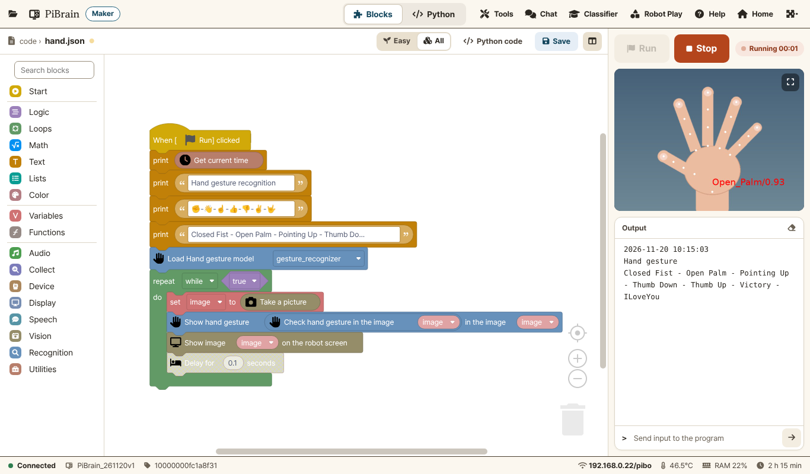
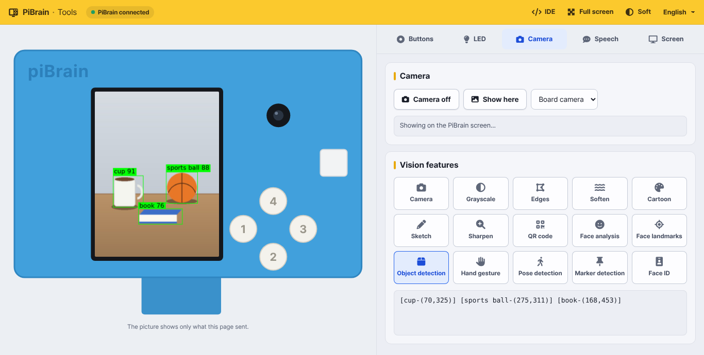
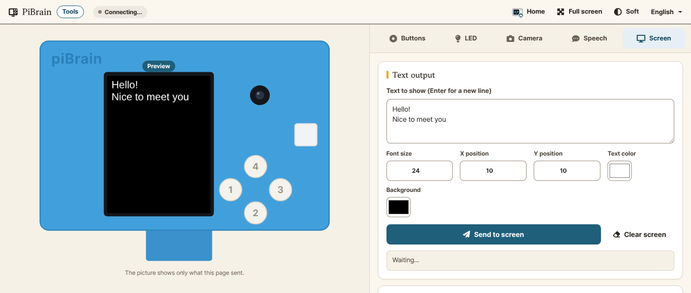

# PiBrain Maker

PiBrain Maker is the PiBrain development environment you open in a web browser. When your tablet or laptop is on the same WiFi
as PiBrain, type **PiBrain's IP address** (shown on the PiBrain screen at startup) into the address bar. There is nothing to install.

The address opens the **home screen** (a worksheet page). Tap a big picture button to enter an app, and use [Home] (house button) in an app's top bar to come back.
Row 1 **Make** (Coding · Tools · Teach AI · Chat), row 2 **Play & learn** (Card coding · Robot Play), row 3 **Teacher tools** (Settings · Help).
The app that is running now gets a red 'Running' stamp and the one you used last gets a yellow tag; on the right are the robot status and [Continue] (recent files, AI you taught).
[Settings] has screen brightness, WiFi settings, reset robot screen, H/W check, factory reset and power off.

| Screen | What it does | Where to open it |
|---|---|---|
| **IDE** | Build and run programs with blocks or Python | `http://<PiBrain IP>` → home screen [Coding] |
| **Tools** | Try the buttons, LED, camera, voice and screen right away, without code | Home screen, or [Tools] at the top of the IDE |
| **Chat** | Chat in text with the language model (LLM) running inside PiBrain | Home screen, or [Chat] at the top of the IDE |
| **Classifier** | Collect examples with the camera and teach your own AI | Home screen, or [Classifier] at the top of the IDE |
| **Card coding** | Elementary students teach the robot friend tricks with cards (no coding) — Challenges · Make · My tricks | Home screen [Card coding] |
| **Robot Play** | **Pet** (look after your robot friend) and **Block Stack**, a block puzzle on the LCD (play with buttons 1–4; the tablet shows the score and records) | Home screen, or [Robot Play] at the top of the IDE |
| **Help** | This document | Home screen, or [Help] at the top of the IDE |

```{note}
Everything runs **inside PiBrain** (voices, chat and the classifier included). Only the blocks in the
[Collect] category (Wikipedia, weather, news) need the internet, and that category is only in the Korean edition.
```

## IDE



- **Top bar**: the folder button on the far left opens the **file drawer**. [Blocks | Python] in the middle switches the editor. On the right are Tools, Chat, Classifier, Robot Play, Help, Full screen and [⋯] More
  (brightness · font size · Python editor theme · language · factory reset · power off · source code and license)
- **File drawer**: the file list, [Add] (new file / new folder / upload) and a preview for pictures and sounds. It is open at first and closes when you open a file or tap the editor.
  Tapping the file name in the editor bar opens it again. The icons on each file download, rename, **copy or move** and delete it.
  To copy or move, choose a folder (code · myimage · myaudio · mymodel · usb) and tap [Copy] or [Move]. It works between a USB drive and the robot too.
  If the name is already taken, the copy gets a new name like `name_1`
- **Start screen**: before you open a file, the workspace shows **[New file] · [Open an example] · [Open my file]**. [Open an example] switches to blocks and opens the examples folder.
  Once a file is open, the editor bar shows the folder and name, like `code › hand.json` (hover to see the full path)
- **Run panel on the right**: **[Run] [Stop]** with the run status, screen output (pictures sent with the `Show image … on the monitor` block), program output and sending input to the program.
  The button at the right end of the editor bar hides or shows it, and it opens again when you run a program. Hide both the drawer and the run panel to give the blocks the whole width
- **Status bar at the bottom**: connection · version · serial | WiFi (tap for WiFi settings) · temperature · memory · uptime
- **Blocks**: drag blocks out of the categories on the left. Type a word such as "sound" or "face" into **Search blocks** at the top to find blocks.
  Choose [Easy] in **[Easy | All]** on the editor bar to see only beginner blocks (repeat forever, motions, lights, sounds, sensors, AI eyes, score and more).
  [Python code] shows the Python code your blocks make. See **Blocks** on the left for every block.
- **When there is an error**: a red box above the output says where (the block outlined in red in block mode, or the line number in Python) and what went wrong in plain words.
  [Show block] / [Show line] takes you there, and the red outline goes away when you change the block


- **Python**: the `openpibo` package gives you every PiBrain feature. `print` goes to [Output] on the right and `input` reads from the input box below it.
  See **Python** on the left for the API
- Programs run inside PiBrain. Press [Stop] to stop one

## Tools

Try PiBrain's features one at a time, without code. Pick [Buttons], [LED], [Camera], [Speech] or [Screen] in the tabs at the top right.
The PiBrain picture on the left follows along: a pressed button lights up, the white square (LED) takes the LED color, and the screen shows the text you send. A [Show here] photo from [Camera] appears on the picture's screen, a speech bubble appears over the picture while [Speech] is talking, and unsent text on the [Screen] tab shows as a preview (only what this page sent appears in the picture).

- **Buttons**: shows live whether each of the 4 buttons is pressed


- **LED**: pick a color and press [Apply] to light the LED in that color



- **Camera**: press [Camera on] to show the camera view on the **PiBrain screen**. Tap a vision feature (grayscale, edges, cartoon, QR code,
  face analysis, object detection, hand gestures, pose, markers…) to apply it to the PiBrain screen right away; the result appears as text at the bottom right.
  **Face ID** recognizes faces you have named and [Registered] (programs can use them too, with the `Load the face dictionary from code facedb` block).
  [Show here] shows the current view in the browser too.
  If a USB camera is plugged in, switch between the **board camera and USB cameras** in the picker next to [Show here] (any USB camera that supports V4L2)
- **Speech**: pick one of ten voices (Male 1–5, Female 1–5) or the robot voice (espeak, English text only) and press [Speak] to let PiBrain say your text. Korean and English are detected automatically



- **Screen**: choose the text, size, position and color and show it on the screen (LCD, 240×320). [Home screen] goes back to the first screen with the IP address

## Classifier


Collect examples with the camera and teach the AI, for example "this is a cat, this is food". The PiBrain camera is portrait (3:4), so the view is portrait too.

**Training steps** at the top of the right panel (① Collect examples → ② Teach the AI → ③ Save and test) outline the step to do now in blue and check off finished steps.

1. **What should it learn from?** — Image (the whole picture) · Hand (hand shape) · Face (expression) · Pose (body posture)
2. Name each **class** and keep pressing **[Hold to collect]** to collect examples. You can also upload files with [Photos].
   The picker under the camera switches to a USB camera — use the same camera for training and for use for better results
3. **[Teach the AI]** — the tablet or laptop browser learns in a few seconds and shows the accuracy, a confusion table and live scores
4. **[Save]** — saved on PiBrain in `/home/pi/mymodel/<model name>`
5. In the IDE use `Load classification model (mymodel) (model name)` → `Classify image (image) with the classification model`.
   `Show the classification result on image (image)` draws the hand, face or body points and the class name on the picture

The [Test] tab tries a saved model again. [Models] lets you test, keep training, rename, download (zip) or delete a model.

```{tip}
The classifier downloads its AI files (about 10 MB) the first time it opens. Open it once on every tablet before class and it
will start right away during class.
```

## Chat

Chat in text with the language model (LLM) that runs inside PiBrain. Choose a model from the **model cards** on the start screen (or **[Chat model]** at the top), and the model loads then
(the first time takes several tens of seconds). Changing the model starts the chat over.

| Model | What it is |
|---|---|
| General | Chats in Korean and English. No tools |
| TheMaker KO | A Korean model trained to talk with students. You can ask PiBrain to do things (tools below) |
| TheMaker EN | The English version of TheMaker. If the model file is not on the robot, it shows "(not installed)" and can't be chosen |

TheMaker listens and **chooses a tool by itself**. The tool it ran appears in small text under the answer (for example `Light red`).

| Tool | Try saying | What it does |
|---|---|---|
| Light | "Turn on the red light", "Turn off the light" | Changes or turns off the LED (red, orange, yellow, green, blue, sky blue, purple, pink, white) |
| Look | "What do you see?" | Looks with the camera and says what it sees |
| Move | "Say hello", "Can you dance?" | Has no body, so it answers that it can't move |

- Say "Let's just talk" to stop using tools, and "You can move now" to use them again.
- Turn on [Speak out loud] and PiBrain speaks the answer (you can choose the voice and volume).

Programs can use it too, with the `Choose chat model`, `Start LLM server` and `Say … to AI` blocks in [Speech].
Blocks chat in text only and do not run tools.

```{note}
Tools, Chat, Classifier, Card coding/Robot Play and H/W check run **one at a time**. Opening one closes the others, and running a program in the IDE closes them too
(they share the camera, speaker and memory). A closed screen shows [Restart].
```
